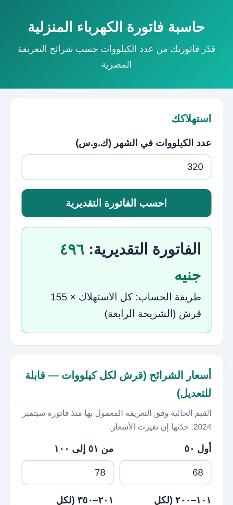

# Home Electricity Bill (Egypt) | حاسبة فاتورة الكهرباء المنزلية

Estimate a home electricity bill in Egypt from the kWh consumed, using the tariff tiers in effect since the September 2024 bill. Arabic interface.

**Live app:** https://abood-ayman.github.io/electricity-bill-eg/

This is a personal project, built with AI tools.

## Features
- Residential tariff tiers in effect since the September 2024 bill (guidance estimate)
- Every rate is editable to match any update or your actual bill
- Shows which tier your consumption reached and how it was priced
- Warns when consumption passes the subsidy limit (over 650 kWh)

## Note
Estimates only: verify against your actual bill; rates change.

## Privacy
Everything runs in your browser. No data is stored or sent anywhere.

## Run locally
Open `index.html` in any browser. It is a single static page with no dependencies.

## Status
Stable.

## Copyright
MIT License - Copyright (c) 2026 Abdullah Ayman.
